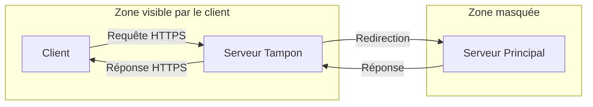
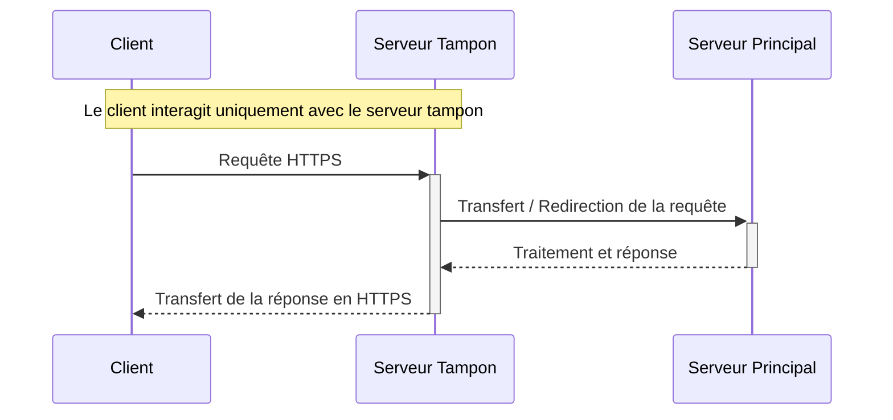
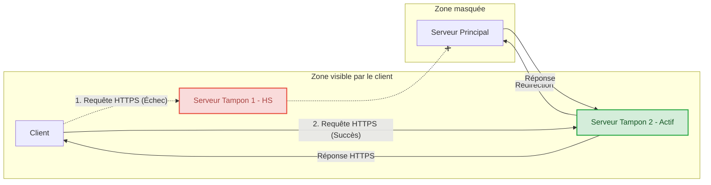
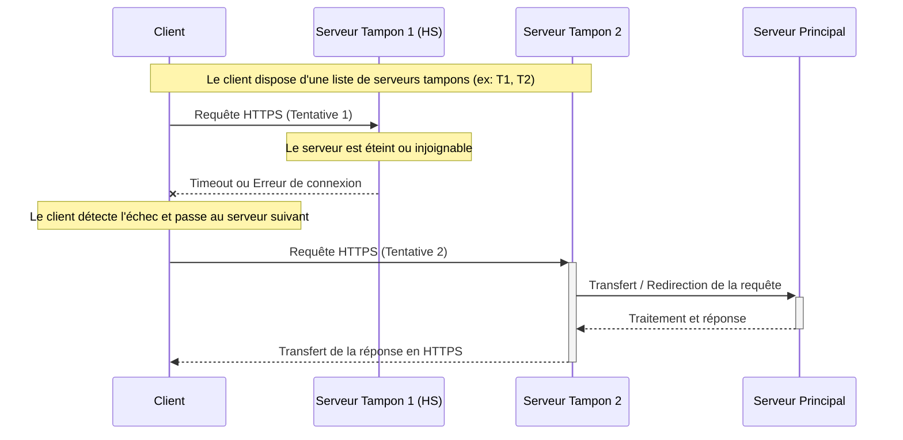
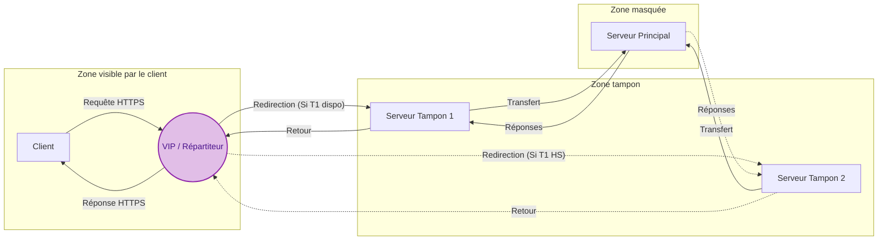
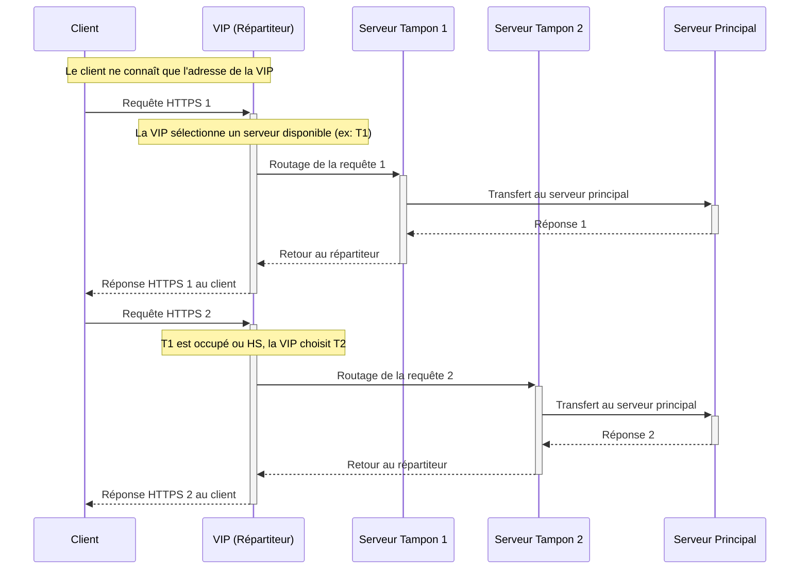

# Proposition d'architecture : isolation de l'infrastructure via un serveur tampon

## 1. Contexte
Dans le cadre du projet, l'infrastructure de notre outil doit impérativement répondre à deux exigences majeures dictées par le cahier des charges : la furtivité face aux solutions de surveillance et la résilience sur la durée. L'exposition directe du serveur principal au client contrevient à cet objectif de discrétion absolue, car elle facilite l'identification et la neutralisation de l'outil.

## 2. Décision
Pour garantir le camouflage et la persistance de l'infrastructure, nous proposons l'évolution architecturale suivante :

*   **Mise en place d'une architecture tampon (VIP et relais multiples) :** Le serveur principal ne sera jamais exposé directement. Le client enverra ses requêtes vers un point d'entrée unique de type VIP (Virtual IP) ou Répartiteur de charge. Cette VIP se chargera de redistribuer le trafic vers l'un des serveurs tampons disponibles en frontal, qui relaiera enfin la requête au serveur principal situé dans une zone masquée.

## 3. Conséquences

### Impacts positifs
*   **Furtivité renforcée (OpSec) :** L'identité et la localisation du serveur principal demeurent totalement invisibles pour le client compromis et les éventuelles solutions de défense[cite: 9].
*   **Haute disponibilité et résilience :** La présence de plusieurs serveurs tampons derrière une VIP permet d'assurer la survie des communications[cite: 9]. Si un relais tombe hors service (HS) ou est bloqué, la VIP redirige automatiquement et de façon transparente le trafic vers le serveur suivant.

### Impacts négatifs
*   **Complexité d'infrastructure :** Cette architecture tripartite nécessite de configurer, de déployer et de maintenir en condition opérationnelle des nœuds réseaux supplémentaires (répartiteur, relais multiples) au lieu d'un simple serveur autonome.

## Proposition 1 : utilisation d'un serveur tampon

### Topologie réseau

### Diagramme de séquence

## Proposition 2 : utilisation de plusieurs serveurs tampons avec basculement

### Topologie réseau

### Diagramme de séquence

## Proposition 3: utilisation de serveurs tampons avec VIP

### Topologie réseau

### Diagramme de séquence
