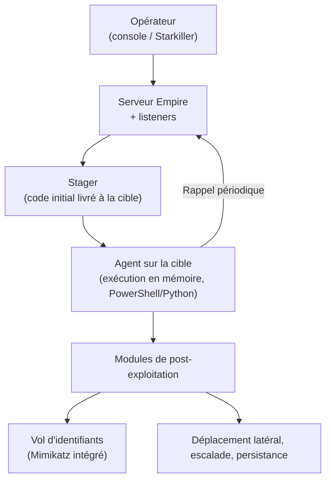

# Empire — présentation et glossaire

Ce document présente Empire — sa nature, son architecture, sa signature technique et sa place dans une attaque — et le complète par un glossaire des termes associés. Il reste au niveau conceptuel, à visée pédagogique et défensive, et ne contient aucune instruction d'utilisation ni mode opératoire.

## Présentation générale

Empire est un framework open source de **post-exploitation et de commande et contrôle (C2)**. À l'origine nommé **PowerShell Empire**, il a été lancé vers 2015 par des chercheurs du Veris Group (dont Will Schroeder, « harmj0y ») et s'est fait connaître parce qu'il reposait entièrement sur **PowerShell**, l'outil d'automatisation intégré à Windows. Il a ensuite gagné des agents en **Python** pour viser aussi Linux et macOS, devenant multiplateforme.

Point d'histoire utile : le projet d'origine a été arrêté par ses créateurs en 2019, puis repris et maintenu par la société **BC Security**, qui le fait évoluer depuis et lui a ajouté une interface graphique, **Starkiller**. Comme la plupart des outils de sécurité offensive, il est à double usage : très employé par les équipes red team, mais aussi largement détourné par de vrais attaquants (dont des groupes APT), ce qui en fait l'un des frameworks les mieux documentés côté défense.

## Sa signature : le « living-off-the-land »

C'est ce qui distingue Empire de frameworks comme Sliver ou Metasploit. Il a popularisé l'approche dite **« living-off-the-land »** : plutôt que de déposer un programme malveillant sur le disque, il utilise des outils déjà présents et légitimes du système (PowerShell au premier chef) et s'exécute **en mémoire**, sans laisser de fichier exécutable à détecter. Pour un antivirus classique, c'est beaucoup plus difficile à repérer, puisqu'il n'y a rien de malveillant posé sur le disque — seulement PowerShell qui s'exécute.

Autre trait marquant : Empire **intègre directement Mimikatz** (via le module *Invoke-Mimikatz*). Le vol d'identifiants devient ainsi une simple fonction du framework, actionnable à distance.

## Place par rapport aux outils voisins

Replacé dans la chronologie d'une intrusion :

- **TheFatRat** fabrique la charge d'entrée.
- **Metasploit** couvre l'exploitation et amorce la post-exploitation.
- **Empire** et **Sliver** sont des frameworks de **C2 et de post-exploitation** : ils interviennent une fois l'accès obtenu, pour tenir le contrôle dans la durée. La particularité d'Empire est son héritage PowerShell et son approche « living-off-the-land ».
- **Mimikatz** est ici intégré comme module : on l'actionne à travers le canal de contrôle.

## Architecture et composants

Trois termes forment le vocabulaire de base d'Empire :

- **Listeners (écouteurs)** : les composants côté serveur qui attendent les connexions des machines compromises. Un listener définit le canal C2 (par exemple HTTP/HTTPS).
- **Stagers** : le code initial livré à la cible. Une fois exécuté, il met en place l'agent complet — c'est l'étape d'amorçage (*staging*).
- **Agents** : l'implant actif sur la machine, qui rappelle le listener et exécute les ordres. L'équivalent de l'implant de Sliver ou du payload de Metasploit.
- **Modules** : les capacités de post-exploitation prêtes à l'emploi — reconnaissance, vol d'identifiants (dont Mimikatz), déplacement latéral, escalade de privilèges, persistance.

La logique d'ensemble : un *listener* attend, un *stager* installe l'*agent*, et l'*agent* exécute les *modules*.

## Place dans une attaque

Comme Sliver, Empire se situe après l'accès initial, dans les phases de **C2 et de post-exploitation**. Il ne force pas la porte ; il prend le relais pour tenir le contrôle, voler des identifiants, se propager et persister. C'est typiquement l'outil avec lequel un attaquant « vit » dans le réseau après l'intrusion.

Le schéma ci-dessous résume cette articulation.

## Détection et défense

La défense contre Empire est très différente de celle d'un C2 classique : comme il s'appuie sur PowerShell, on le combat surtout en **instrumentant PowerShell**.

- **Journalisation PowerShell avancée** : *script block logging* (journalise le code réellement exécuté, même obfusqué), *module logging* et transcription — la mesure la plus efficace.
- **AMSI** (*Antimalware Scan Interface*) : mécanisme Windows permettant à l'antivirus d'inspecter le contenu des scripts au moment de leur exécution en mémoire, y compris ce qui n'est jamais écrit sur le disque.
- **Constrained Language Mode** : mode qui bride les capacités de PowerShell pour les comptes qui n'en ont pas besoin.
- **EDR et analyse comportementale**, et **détection du beaconing** réseau, comme pour tout C2.
- **IoC** publiés par la communauté, le framework étant très étudié.

## Glossaire

| Terme | Définition |
| --- | --- |
| Post-exploitation | L'ensemble des actions menées une fois l'accès à une machine obtenu : collecte, vol d'identifiants, propagation, persistance. |
| C2 / Command and Control | L'infrastructure par laquelle un attaquant pilote à distance les machines compromises et leur transmet des ordres. |
| PowerShell | Outil d'automatisation et langage de script intégré à Windows, sur lequel repose historiquement Empire. |
| Living-off-the-land (LOLBin) | Technique consistant à utiliser des outils légitimes déjà présents sur le système plutôt que d'y déposer un malware, pour échapper à la détection. |
| Exécution en mémoire | Exécution d'un code sans l'écrire sur le disque, ce qui le rend plus difficile à détecter par un antivirus classique. |
| Listener (écouteur) | Composant côté serveur qui attend les connexions des machines compromises et définit le canal C2. |
| Stager | Code initial livré à la cible, qui met en place l'agent complet une fois exécuté. |
| Agent | L'implant actif sur la machine compromise, qui rappelle le listener et exécute les ordres. |
| Module | Capacité de post-exploitation prête à l'emploi au sein du framework (reconnaissance, identifiants, latéralisation, persistance). |
| Beaconing | Rappel périodique d'un agent vers son serveur ; sa régularité est un signal de détection côté réseau. |
| Invoke-Mimikatz | Module intégrant Mimikatz à Empire pour le vol d'identifiants, actionnable à distance. |
| Starkiller | Interface graphique d'Empire, développée par BC Security. |
| BC Security | Société qui maintient et fait évoluer Empire depuis l'arrêt du projet d'origine en 2019. |
| AMSI (Antimalware Scan Interface) | Mécanisme Windows permettant à un antivirus d'inspecter le contenu des scripts au moment de leur exécution, y compris en mémoire. |
| Script block logging | Journalisation PowerShell qui enregistre le code réellement exécuté ; une des défenses les plus efficaces contre Empire. |
| Constrained Language Mode | Mode restreignant les capacités de PowerShell pour limiter son usage offensif. |
| APT (Advanced Persistent Threat) | Acteur malveillant sophistiqué et persistant, souvent étatique ; Empire figure parmi les outils que ce type d'acteur a employés. |
| Double usage | Qualifie un outil employé aussi bien à des fins légitimes (test d'intrusion) que malveillantes. |