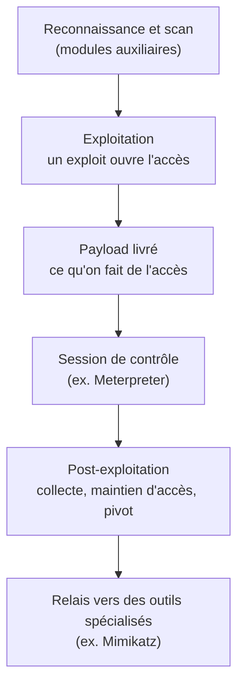

# Metasploit — présentation et glossaire

Ce document présente Metasploit — sa nature, son architecture et sa place dans une attaque — et le complète par un glossaire des termes associés. Il reste au niveau conceptuel, à visée pédagogique et défensive, et ne contient aucune instruction d'utilisation ni mode opératoire.

## Présentation générale

Metasploit (le *Metasploit Framework*) est le cadre logiciel de test d'intrusion le plus répandu dans le monde. Son principe : plutôt que chaque professionnel réécrive ses propres outils, il rassemble dans une boîte à outils organisée des milliers de briques d'attaque réutilisables, prêtes à être sélectionnées et combinées.

C'est un projet open source, maintenu par l'entreprise Rapid7. Comme la plupart des outils de sécurité offensive, il est à double usage : conçu et employé légitimement par les équipes de test d'intrusion et de red team, mais également détourné par des acteurs malveillants.

Sa particularité par rapport à un outil mono-tâche tient à son ampleur : ce n'est pas un utilitaire isolé, mais une **plateforme** complète, dotée d'une interface et d'une logique communes, et d'une bibliothèque tenue à jour par une large communauté. C'est ce qui en fait à la fois une référence professionnelle et un objet d'étude incontournable.

## Architecture et modules

Metasploit s'organise autour de **modules** : des briques spécialisées, indépendantes, que l'on sélectionne et combine selon le besoin. Les grandes catégories sont les suivantes.

- **Exploits** : modules qui tirent parti d'une vulnérabilité précise pour obtenir un accès. Chaque exploit vise une faille particulière d'un logiciel ou d'un système ; c'est la « clé » qui ouvre une porte donnée.
- **Payloads (charges utiles)** : ce qui s'exécute sur la cible une fois l'accès obtenu — l'action concrète recherchée. On y trouve notamment les charges ouvrant une connexion de retour vers l'attaquant (*reverse*) et surtout **Meterpreter**, charge avancée emblématique du framework, qui offre un accès interactif et riche à la machine. C'est la brique que des outils comme TheFatRat cherchent à produire.
- **Modules auxiliaires** : tout ce qui n'est pas de l'exploitation directe — scanners, reconnaissance, collecte d'informations.
- **Modules de post-exploitation** : ce qu'on utilise une fois déjà entré (collecte, pivot vers d'autres machines, maintien d'accès). C'est conceptuellement la zone où intervient un outil comme Mimikatz.
- **Encoders et NOPs** : modules qui mettent en forme les charges, notamment pour des raisons de compatibilité. C'est aussi dans cette zone que se logent des tentatives d'évasion des antivirus, non détaillées ici.

La logique d'ensemble tient en une phrase : un exploit ouvre l'accès, un payload définit ce qu'on en fait. Ces deux briques étant indépendantes, un même payload peut être livré par de nombreux exploits différents, et inversement — c'est la souplesse qui fait la force du framework.

## Composants et interfaces

Deux composants reviennent constamment et aident à relier Metasploit à des outils qui s'appuient dessus.

- **msfconsole** : l'interface principale, en ligne de commande, depuis laquelle on sélectionne et pilote les modules. C'est le « poste de pilotage » du framework.
- **msfvenom** : le composant dédié à la génération de payloads sous forme de fichiers autonomes (un exécutable, un paquet Android, etc.). C'est précisément le moteur que TheFatRat actionne en coulisses pour produire ses fichiers piégés : comprendre msfvenom, c'est comprendre ce que fait TheFatRat au fond.

Autrement dit, là où msfconsole sert à conduire une session d'attaque de bout en bout, msfvenom se concentre sur une étape — fabriquer la charge — et peut être utilisé indépendamment du reste.

## Place dans un test d'intrusion

Metasploit accompagne la plupart des étapes d'un test d'intrusion, ce qui explique sa place centrale :

1. **Reconnaissance et scan** — identifier machines, services et failles potentielles (modules auxiliaires).
2. **Exploitation** — tirer parti d'une vulnérabilité pour obtenir un accès (modules exploit).
3. **Charge et session** — le payload livré établit une session de contrôle sur la machine ; une charge comme Meterpreter donne un accès interactif.
4. **Post-exploitation** — une fois entré : collecte d'informations, maintien d'accès, et pivot vers d'autres machines du réseau.

La colonne vertébrale de cette logique reste l'articulation entre exploit et payload : le premier ouvre l'accès, le second définit ce qu'on en fait. Leur combinaison libre permet d'adapter une même charge à de nombreux points d'entrée, et de standardiser un enchaînement qui, autrement, serait éclaté entre des dizaines d'outils séparés.

Situé dans la chronologie d'une intrusion, Metasploit couvre donc surtout l'accès initial et l'exploitation, et amorce la post-exploitation — étape où prennent le relais des outils spécialisés comme Mimikatz pour le vol d'identifiants et la progression vers le contrôle du domaine.

Le schéma ci-dessous résume cet enchaînement, de la reconnaissance à la post-exploitation.

## Glossaire

| Terme | Définition |
| --- | --- |
| Framework de test d'intrusion | Plateforme logicielle regroupant des outils d'attaque réutilisables et organisés, destinée à évaluer la sécurité d'un système de façon méthodique. |
| Exploit | Module qui tire parti d'une vulnérabilité précise pour obtenir un accès. La « clé » qui ouvre une porte donnée. |
| Payload (charge utile) | Ce qui s'exécute sur la machine cible une fois l'accès obtenu — l'action concrète recherchée par l'attaquant. |
| Meterpreter | Charge avancée emblématique de Metasploit, qui offre un accès interactif et riche à la machine compromise. |
| Connexion inverse (reverse shell) | Au lieu que l'attaquant se connecte à la victime, c'est la machine infectée qui initie la connexion vers l'attaquant — un moyen de contourner les pare-feux, qui bloquent surtout les connexions entrantes. |
| Session | Le canal de contrôle établi sur une machine une fois le payload actif ; c'est à travers elle que l'attaquant interagit avec la cible. |
| Module auxiliaire | Module qui ne fait pas d'exploitation directe : scan, reconnaissance, collecte d'informations. |
| Module de post-exploitation | Module utilisé une fois déjà entré : collecte, maintien d'accès, pivot vers d'autres machines. |
| Encoder | Module qui met en forme un payload, notamment pour des raisons de compatibilité. |
| msfconsole | L'interface principale en ligne de commande de Metasploit : le « poste de pilotage » depuis lequel on sélectionne et pilote les modules. |
| msfvenom | Le composant de Metasploit dédié à la génération de payloads en fichiers autonomes. C'est le moteur que TheFatRat actionne en coulisses. |
| Point de pivot (pivoting) | Utilisation d'une machine déjà compromise comme tremplin pour atteindre d'autres machines du réseau, inaccessibles directement. |
| C2 / Command and Control | Le serveur de l'attaquant auquel la machine compromise se connecte pour recevoir des ordres. Repérer ce trafic est un axe majeur de détection. |
| Rapid7 | L'entreprise de cybersécurité qui maintient le Metasploit Framework. |
| Double usage | Qualifie un outil employé aussi bien à des fins légitimes (test d'intrusion) que malveillantes. |
