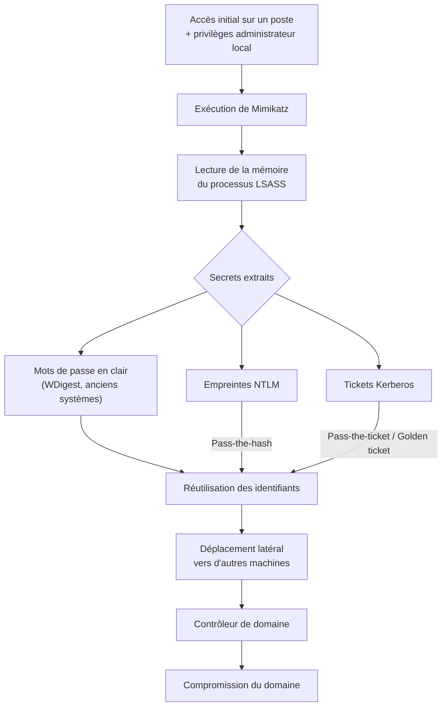

# Mimikatz — présentation et glossaire

Ce document présente l'outil Mimikatz — sa nature, son fonctionnement et la valeur qu'il représente pour un attaquant — et le complète par un glossaire des termes associés.

## Présentation générale

Mimikatz est un outil open source de sécurité offensive développé par le chercheur français Benjamin Delpy (« gentilkiwi ») à partir de 2011. Il automatise l'extraction et la réutilisation des secrets d'authentification Windows — identifiants, empreintes, tickets Kerberos — conservés en mémoire par le système.

Il relève de la catégorie des outils de post-exploitation : il ne compromet pas une machine par lui-même, mais exploite un accès déjà obtenu pour collecter des identifiants et étendre la compromission. Outil à double usage, il est employé aussi bien par des acteurs malveillants que, dans un cadre légitime, par les équipes de test d'intrusion et de red team. Il figure à ce titre dans les référentiels de référence tels que MITRE ATT&CK.

Sa particularité, et la difficulté qu'il pose en défense, tient à ce qu'il n'exploite pas une vulnérabilité isolée : il détourne des mécanismes légitimes de Windows, notamment la mise en cache des secrets d'authentification destinée à éviter les ressaisies (authentification unique). Il ne peut donc pas être neutralisé par un simple correctif ; sa maîtrise relève d'un durcissement de la gestion des identités.

## Fonctionnement

Le fonctionnement de Mimikatz repose sur l'accès à la mémoire du processus **LSASS** (*Local Security Authority Subsystem Service*), qui gère l'authentification locale et conserve en mémoire les secrets des sessions ouvertes. Cet accès requiert des privilèges élevés : droits d'administrateur local, puis le privilège `SeDebugPrivilege`. L'outil lit alors l'espace mémoire du processus et y localise les structures contenant les secrets.

Les éléments extraits sont de trois ordres :

- **Mots de passe en clair** : sur les anciennes versions de Windows, le fournisseur WDigest conservait une copie du mot de passe en clair en mémoire. Ce comportement, à l'origine de la notoriété de l'outil, a été corrigé par Microsoft à partir de 2014 (WDigest désactivé par défaut).
- **Empreintes de mots de passe (hash NTLM)** : représentation dérivée du mot de passe, qui n'en révèle pas la valeur mais suffit à s'authentifier auprès des protocoles qui l'acceptent.
- **Tickets Kerberos** : jetons d'authentification délivrés au sein d'un domaine Active Directory, que l'outil peut extraire de la mémoire ou forger.

Au-delà de la lecture de LSASS, Mimikatz sait également interagir avec les protocoles d'authentification eux-mêmes. Il peut, par exemple, se faire passer pour un contrôleur de domaine afin d'obtenir par réplication les empreintes de comptes du domaine (technique *DCSync*), sans accéder directement à la mémoire du contrôleur.

Le schéma ci-dessous résume ce fonctionnement et son enchaînement avec la suite de l'attaque.

## Intérêt pour un attaquant

La valeur de Mimikatz pour un attaquant tient à ce qu'il convertit la compromission d'une seule machine en capacité de progression sur l'ensemble du système d'information. Les secrets extraits permettent d'usurper l'identité d'utilisateurs légitimes sans connaître leurs mots de passe, et donc de se déplacer en se fondant dans un trafic d'authentification normal.

Les techniques associées sont principalement :

- **Pass-the-hash** : authentification auprès d'un service au moyen de l'empreinte NTLM d'un compte, sans le mot de passe correspondant.
- **Pass-the-ticket** : réutilisation d'un ticket Kerberos dérobé pour se faire passer pour son titulaire.
- **Dǩplacement latéral** : réutilisation des secrets collectés pour atteindre de nouvelles machines, où sont à leur tour extraits les secrets de comptes plus privilégiés.
- **Golden ticket** : forge de tickets Kerberos arbitraires après compromission du secret du compte `krbtgt`, qui signe l'ensemble des tickets du domaine. Ces tickets sont difficiles à détecter et survivent au renouvellement du mot de passe des comptes usurpés.

L'enjeu, du point de vue offensif, n'est donc pas la seule récupération de mots de passe, mais l'obtention de moyens d'authentification persistants et discrets permettant de remonter la chaîne de privilèges jusqu'au contrôle du domaine.

## Chaîne d'attaque type

La place de Mimikatz s'illustre dans une progression caractéristique d'une compromission de domaine :

1. **Accès initial** — l'attaquant prend pied sur un premier poste (hameçonnage, exploitation d'une vulnérabilité, etc.) et obtient des privilèges d'administrateur local.
2. **Extraction des secrets** — Mimikatz est exécuté pour lire la mémoire de LSASS et en extraire empreintes et tickets.
3. **Déplacement latéral** — les secrets collectés sont réutilisés pour atteindre d'autres machines, dont celles de comptes à privilèges plus élevés.
4. **Escalade vers le domaine** — de proche en proche, l'attaquant atteint le contrôleur de domaine ; en le contrôlant, il dispose de l'ensemble des comptes et des ressources de l'organisation.

Cette progression justifie l'approche défensive dominante : partir de l'hypothèse qu'un poste sera compromis et cloisonner l'environnement de sorte qu'une intrusion reste circonscrite et détectable, plutôt que de viser un périmètre réputé infranchissable.

## Glossaire

| Terme | Définition |
| --- | --- |
| Active Directory / domaine | Un domaine est un réseau d'entreprise où tous les comptes, mots de passe et règles sont gérés de façon centralisée. Active Directory est la technologie Windows qui gère ça. |
| Contrôleur de domaine | Le serveur « chef d'orchestre » d'un domaine : il détient l'annuaire de tous les comptes, vérifie les identités et délivre les tickets Kerberos. En prendre le contrôle, c'est contrôler toute l'entreprise. |
| Credential Guard | Protection Windows qui range les secrets d'authentification dans une « pièce blindée » isolée par virtualisation, qu'un administrateur local ne peut pas lire. La parade la plus efficace contre l'extraction par Mimikatz. |
| DCSync | Technique où l'attaquant se fait passer pour un contrôleur de domaine et demande la réplication des empreintes de mots de passe, en abusant d'un mécanisme légitime d'Active Directory. |
| EDR | « Endpoint Detection and Response » : un antivirus avancé qui surveille les comportements, repère par exemple un accès suspect à la mémoire de LSASS et connaît la signature de Mimikatz. |
| Empreinte (hash) de mot de passe | Une version transformée du mot de passe. On ne voit pas le mot de passe lui-même, mais cette empreinte peut suffire à s'authentifier à sa place. |
| Golden ticket | Faux ticket Kerberos « tout-puissant » fabriqué par l'attaquant après avoir volé le secret du compte krbtgt. Indétectable et très durable. |
| Kerberos | Le système de tickets qui gère l'authentification dans un réseau d'entreprise. Image : un festival où l'on montre son identité une fois pour recevoir un bracelet, présenté ensuite partout. |
| krbtgt | Le compte spécial d'un domaine dont le secret sert à signer tous les tickets Kerberos. Le « tampon officiel » : s'il est volé, l'attaquant peut forger n'importe quel ticket (golden ticket). |
| LAPS | « Local Administrator Password Solution » : donne à chaque machine un mot de passe administrateur local unique et tournant, pour qu'un secret volé sur un poste ne serve pas sur les autres. |
| LSASS | Le programme Windows qui vérifie les identités (le « concierge ») et garde les secrets d'authentification en mémoire. C'est cette mémoire que Mimikatz lit. |
| Moindre privilège | Principe consistant à ne donner que les droits strictement nécessaires. Comme Mimikatz exige les droits administrateur, un utilisateur non-administrateur bride largement l'outil. |
| Pass-the-hash | S'authentifier en présentant l'empreinte d'un mot de passe, sans connaître le mot de passe lui-même. |
| Pass-the-ticket | Réutiliser un ticket Kerberos (un « bracelet ») volé pour se faire passer pour sa victime. |
| SIEM | Système qui collecte et analyse les journaux d'activité du réseau pour lever des alertes sur les comportements anormaux. Sert à repérer vite une attaque qu'on n'a pas pu empêcher. |
| Ticket Kerberos | La « preuve d'identité » (le bracelet) délivrée par le contrôleur de domaine, présentée aux services du réseau à la place du mot de passe. |
| WDigest | Ancien composant Windows qui gardait le mot de passe en clair en mémoire. Désactivé par défaut depuis des années, mais à vérifier. |
