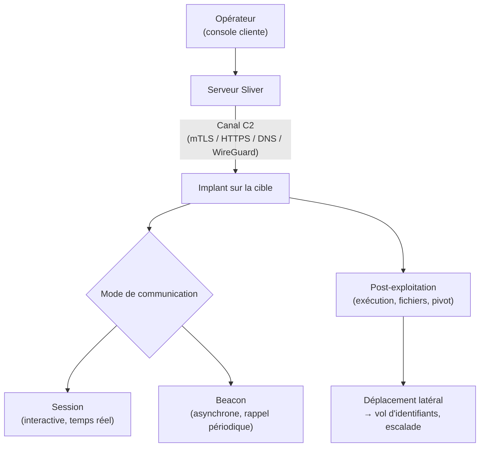

# Sliver — présentation et glossaire

Ce document présente Sliver — sa nature, son architecture, ses capacités et sa place dans une attaque — et le complète par un glossaire des termes associés. Il reste au niveau conceptuel, à visée pédagogique et défensive, et ne contient aucune instruction d'utilisation ni mode opératoire.

## Présentation générale

Sliver est un framework open source de **commande et contrôle (C2)** et d'émulation d'adversaire, développé par la société Bishop Fox. Son rôle : fournir aux équipes offensives l'infrastructure pour piloter à distance des machines compromises au cours d'un test d'intrusion ou d'un exercice red team.

On le situe le plus simplement en le comparant à **Cobalt Strike**, la référence commerciale du C2 : Sliver est né en grande partie comme une alternative **libre et gratuite** à cet outil. Comme la plupart des outils de sécurité offensive, il est à double usage — conçu pour un emploi légitime, mais également détourné par des acteurs malveillants — et il est aujourd'hui bien suivi par les défenseurs.

Écrit en **Go**, il est **multiplateforme** : il génère des agents pour Windows, Linux et macOS à partir d'une même base de code.

## Place par rapport aux outils voisins

Replacé dans la chronologie d'une intrusion :

- **TheFatRat** fabrique la charge d'entrée.
- **Metasploit** couvre l'exploitation et amorce la post-exploitation.
- **Sliver** est un framework de **post-exploitation et de C2** : il intervient une fois l'accès obtenu, pour tenir le canal de contrôle dans la durée et conduire les opérations sur la machine et le réseau.
- **Mimikatz** est l'un des outils que l'on actionne *à travers* ce type de canal, pour voler des identifiants.

Là où Metasploit est centré sur « ouvrir la porte », Sliver est spécialisé dans « garder le contrôle une fois à l'intérieur », discrètement et dans la durée.

## Architecture et composants

- **Le serveur Sliver** : le cœur de l'infrastructure, qui reçoit les connexions des machines compromises et centralise les opérations.
- **La console opérateur (client)** : l'interface depuis laquelle l'opérateur pilote. Sliver gère un **mode multijoueur**, où plusieurs opérateurs d'une même équipe travaillent sur la même infrastructure.
- **L'implant** : l'agent déposé sur la machine cible — le programme qui « rappelle » le serveur et exécute les ordres. C'est l'équivalent du *payload* de Metasploit, mais pensé pour durer.

## Deux notions caractéristiques

**Sessions et beacons.** Un implant peut fonctionner de deux façons :

- en **session** : une connexion interactive, en temps réel — pratique, mais plus bruyante, donc plus repérable ;
- en **beacon** : l'implant se contente de rappeler le serveur par intermittence (à intervalles réguliers, avec une part d'aléa appelée *jitter*), pour recevoir ses ordres puis se taire. C'est beaucoup plus discret, et c'est le mode qui complique le plus la détection.

**Les canaux de communication (transports).** Sliver sait faire transiter son trafic C2 par plusieurs protocoles — **mTLS, HTTP(S), DNS, WireGuard**. Cette variété lui permet de se fondre dans du trafic d'apparence légitime et de s'adapter à différents environnements réseau ; le canal DNS, en particulier, est connu pour se faufiler là où d'autres sont bloqués.

## Capacités (vue conceptuelle)

Une fois l'implant actif, le framework offre les capacités classiques de post-exploitation : exécution de commandes, manipulation de fichiers, **pivot** vers d'autres machines du réseau, et extension des fonctions via un système de modules (l'**armory**). L'idée à retenir est qu'il s'agit d'une boîte à outils de **contrôle à distance**, et non d'un simple accès ponctuel.

## Place dans une attaque

Sliver correspond aux phases de **contrôle (C2) et de post-exploitation** d'une intrusion : il n'ouvre pas la porte lui-même, mais prend le relais une fois l'accès initial obtenu pour maintenir le contrôle et conduire les opérations. Les actions qui suivent — vol d'identifiants, déplacement latéral, escalade de privilèges — s'appuient sur ce canal et font intervenir des outils spécialisés comme Mimikatz.

Le schéma ci-dessous résume cette articulation.

## Détection et défense

On ne défend pas contre Sliver en corrigeant une faille (il n'en exploite pas), mais en repérant son **comportement** :

- **Détecter le *beaconing*** : des connexions sortantes régulières vers un même hôte, à intervalles réguliers même « bruités » par le jitter, constituent un signal fort.
- **Analyser le trafic chiffré** : les techniques d'empreinte TLS (type JA3/JA3S) peuvent repérer des signatures associées à ce genre d'outil.
- **Surveiller le DNS** : des requêtes anormalement nombreuses ou volumineuses trahissent un tunnel.
- **EDR et analyse comportementale** sur les postes : injection de processus, comportements d'implant connus.
- **S'appuyer sur les IoC** (indicateurs de compromission) publiés par la communauté, les implants Sliver ayant été largement étudiés.

## Glossaire

| Terme | Définition |
| --- | --- |
| C2 / Command and Control | L'infrastructure par laquelle un attaquant pilote à distance les machines compromises et leur transmet des ordres. |
| Framework C2 / d'émulation d'adversaire | Plateforme outillée qui fournit toute l'infrastructure de contrôle à distance, utilisée pour simuler le comportement d'un attaquant lors d'exercices de sécurité. |
| Implant | L'agent déposé sur la machine cible, qui rappelle le serveur et exécute les ordres reçus. Équivalent durable d'un payload. |
| Session | Mode de communication interactif, en temps réel, entre l'implant et le serveur — réactif mais plus facile à repérer. |
| Beacon | Mode de communication asynchrone : l'implant rappelle le serveur par intermittence pour recevoir ses ordres, puis se tait. Plus discret qu'une session. |
| Jitter | Variation aléatoire ajoutée à l'intervalle des rappels d'un beacon, pour brouiller la régularité et compliquer la détection. |
| Transport C2 | Le protocole réseau servant à faire transiter le trafic de commande et contrôle (mTLS, HTTP(S), DNS, WireGuard). |
| mTLS | TLS mutuellement authentifié : les deux extrémités se vérifient par certificat, ce qui sécurise et authentifie le canal C2. |
| Tunnel DNS | Détournement du protocole DNS pour faire passer des données ou des ordres, souvent là où d'autres canaux sont bloqués. |
| Mode multijoueur | Fonctionnalité permettant à plusieurs opérateurs d'une même équipe de travailler sur la même infrastructure Sliver. |
| Armory | Le système de modules/extensions de Sliver, qui ajoute des capacités à un implant. |
| Pivot (pivoting) | Utilisation d'une machine déjà compromise comme tremplin pour atteindre d'autres machines du réseau. |
| Cobalt Strike | Framework C2 commercial de référence, dont Sliver constitue une alternative libre. |
| Go (Golang) | Le langage de programmation dans lequel Sliver est écrit, à l'origine de son caractère multiplateforme. |
| JA3 / JA3S | Techniques d'empreinte des connexions TLS, utilisées côté défense pour reconnaître certains outils malgré le chiffrement. |
| IoC (indicateur de compromission) | Élément observable (adresse, empreinte, comportement) permettant de reconnaître la présence d'un outil ou d'une attaque. |
| Double usage | Qualifie un outil employé aussi bien à des fins légitimes (test d'intrusion) que malveillantes. |
