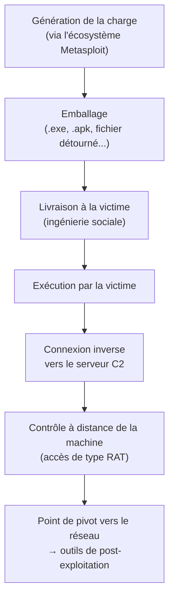

# TheFatRat — présentation et glossaire

Ce document présente TheFatRat — sa nature, les artefacts qu'il produit, leur comportement et sa place dans une attaque — et le complète par un glossaire des termes associés. Il reste au niveau conceptuel, à visée pédagogique et défensive : il décrit ce que l'outil produit et comment s'en protéger, sans aucun mode opératoire ni instruction de fabrication.

## Présentation générale

TheFatRat est un outil open source (diffusé notamment via GitHub) qui automatise la création de portes dérobées et de charges malveillantes. En pratique, c'est une surcouche « assistée » par-dessus l'écosystème Metasploit — en particulier msfvenom — qui abaisse fortement la barrière technique de génération d'un fichier piégé. C'est cette accessibilité qui l'a rendu populaire, et qui explique son association fréquente avec les *script kiddies*.

Situé par rapport aux outils voisins : TheFatRat intervient **en amont**, à l'étape de « fabrication de l'arme » (le fichier malveillant), là où Metasploit orchestre une attaque complète et où Mimikatz agit une fois déjà entré sur la machine.

Il faut le dire clairement, car c'est important côté défense : les charges produites par ce type d'outil sont aujourd'hui **très largement détectées** par les antivirus et EDR modernes. TheFatRat est donc surtout un objet pédagogique et un marqueur historique de l'automatisation de la création de malwares accessibles aux débutants, plus qu'une menace de pointe. Il est présenté ici dans cette optique : comprendre ce qu'il produit pour mieux le reconnaître et s'en protéger.

## Ce que TheFatRat produit

L'outil ne produit qu'une grande famille de choses : des **programmes piégés contenant une charge d'accès distant**. Quel que soit l'emballage, le « cœur » est presque toujours le même — une porte dérobée qui rappelle l'attaquant. Ce qui varie, c'est la forme de l'emballage et la plateforme visée.

- **Exécutables Windows piégés** : un fichier au format exécutable Windows (type `.exe`) qui, lancé par la victime, déclenche la charge en arrière-plan ; pour l'utilisateur, le fichier peut sembler anodin ou ne rien faire de visible.
- **Fichiers « légitimes » détournés** : la charge est adossée à un fichier d'apparence normale et attendue (un installeur, un utilitaire, un document). La victime voit le comportement qu'elle attend, sans soupçonner la charge en parallèle. C'est un artefact de type **trojan** au sens strict : du malveillant déguisé en contenu de confiance.
- **Applications Android (`.apk`) piégées** : des applications pour smartphone qui, une fois installées, ouvrent un accès distant au téléphone — une cible à part entière, distincte du poste Windows.
- **Charges intégrées à des documents** : des documents bureautiques (type fichiers à macros) servant de leurre, dont l'ouverture/activation déclenche la charge.

Dans tous les cas, le vecteur d'arrivée chez la victime relève de l'**ingénierie sociale** : l'outil fabrique l'arme, il ne la livre pas.

## Comportement des charges produites

C'est l'essentiel, et c'est le même socle quelle que soit l'enveloppe. La charge est généralement de type **Meterpreter** (issue de l'écosystème Metasploit) ou équivalente, et vise un **contrôle à distance interactif**. Ce genre de porte dérobée permet typiquement à l'attaquant de :

- **établir une connexion de retour** vers son serveur de commande (C2), le plus souvent en *reverse* — c'est la machine infectée qui appelle l'attaquant, ce qui facilite le passage des pare-feux ;
- **parcourir et manipuler les fichiers** : lister, télécharger (exfiltration), déposer ou supprimer ;
- **exécuter des commandes** sur la machine ;
- **surveiller l'utilisateur** : captures d'écran, enregistrement des frappes clavier (*keylogging*), et selon la plateforme accès webcam ou micro ;
- sur **Android**, accéder à des données du téléphone (SMS, journal d'appels, localisation, contacts, fichiers) selon les permissions obtenues ;
- **persister** : se maintenir après un redémarrage pour ne pas perdre l'accès ;
- **servir de point de pivot** : la machine contrôlée devient le tremplin pour aller plus loin dans le réseau.

## Place dans une attaque

L'artefact produit par TheFatRat correspond à la phase d'**accès initial** et d'**installation** d'une intrusion : il crée le point d'entrée (la porte dérobée) et le canal de contrôle. Ce qui vient ensuite — vol d'identifiants, déplacement latéral, escalade vers le domaine — ne relève plus de cet outil mais des étapes suivantes, celles que l'on retrouve avec Metasploit (en post-exploitation) et Mimikatz.

Le schéma ci-dessous résume ce cycle de vie, de la fabrication au contrôle à distance.

## Détection et défense

Les charges produites par ce type d'outil sont aujourd'hui bien connues des défenseurs, ce qui en limite fortement l'efficacité réelle. Les axes de protection classiques tiennent tous :

- **Ne jamais exécuter de fichier non fiable**, et se méfier des fichiers reçus même d'apparence légitime.
- **Formation des utilisateurs** contre l'ingénierie sociale — le maillon humain est le vecteur principal.
- **Contrôle des applications autorisées à s'exécuter** (*allowlisting*) : bloquer par défaut tout programme inconnu.
- **Antivirus et EDR** à jour : détection par signature et par analyse comportementale (un processus qui prend des captures d'écran, une connexion sortante inattendue, etc.).
- **Surveillance du trafic réseau sortant** : repérer les communications vers un serveur de contrôle (C2) est un axe de détection majeur.

## Glossaire

| Terme | Définition |
| --- | --- |
| Porte dérobée (backdoor) | Accès caché à un système, laissé par un attaquant pour y revenir à volonté en contournant l'authentification normale. |
| Charge utile (payload) | La partie d'un programme malveillant qui exécute l'action voulue par l'attaquant — ici, ouvrir un accès distant. |
| RAT (Remote Access Trojan) | « Cheval de Troie d'accès à distance » : programme qui donne à l'attaquant le contrôle à distance de la machine infectée, à l'insu de l'utilisateur. |
| Trojan (cheval de Troie) | Contenu malveillant déguisé en contenu de confiance, pour que la victime l'exécute volontairement. |
| Connexion inverse (reverse shell) | C'est la machine infectée qui initie la connexion vers l'attaquant, et non l'inverse — un moyen de contourner les pare-feux, qui bloquent surtout les connexions entrantes. |
| C2 / Command and Control | Le serveur de l'attaquant auquel la machine infectée se connecte pour recevoir des ordres. Repérer ce trafic est un axe majeur de détection. |
| Meterpreter | Charge avancée issue de Metasploit, offrant un accès interactif et riche à la machine compromise. C'est le type de charge que TheFatRat emballe souvent. |
| Metasploit | Framework de test d'intrusion très répandu, sur lequel TheFatRat s'appuie en coulisses. |
| msfvenom | Le composant de Metasploit qui génère les charges en fichiers autonomes — le « moteur » que TheFatRat actionne. |
| APK | Format de paquet d'application Android ; l'un des types de fichiers piégés que l'outil peut produire. |
| Dropper | Programme dont le rôle est d'installer (de « déposer ») la véritable charge malveillante sur la machine. |
| Persistance | Capacité d'un malware à se maintenir actif après un redémarrage, pour ne pas perdre l'accès. |
| Point de pivot (pivoting) | Utilisation d'une machine déjà compromise comme tremplin pour atteindre d'autres machines du réseau. |
| Ingénierie sociale | Manipulation de la victime pour la pousser à exécuter le fichier — le maillon humain, souvent le plus faible. |
| Allowlisting (liste d'autorisation) | Défense qui n'autorise l'exécution que d'applications explicitement approuvées, bloquant par défaut tout programme inconnu. |
| Script kiddie | Personne menant des attaques à l'aide d'outils tout faits, sans en maîtriser les mécanismes sous-jacents. |
